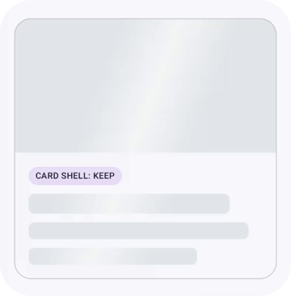

  

---

### WeList &nbsp;

Shared shopping lists for groups, built with Kotlin Multiplatform and Compose Multiplatform. Create a party, invite people and check off items together. One codebase for Android, iOS, Desktop and Web, in English and German, with light and dark themes. Coming soon.

---

### compose-skeleton &nbsp;

Layout-aware skeleton placeholders with one synchronized shimmer for Compose Multiplatform. You keep building the real component and add `Modifier.skeleton()` where you would add a background. Four modes (`Shimmer`, `Solid`, `Keep`, `Hide`) decide what each element does while loading, and the style is fully customizable: colors, shape, shimmer width, tilt, speed and direction. Published on [Maven Central](https://central.sonatype.com/artifact/io.github.manug243/compose-skeleton) for Android, Desktop and iOS, all from `commonMain`.

 

---

### gello-app &nbsp;

A Kotlin Multiplatform demo app for lab journals with gel image analysis (Android, iOS, Desktop). Sign in, organize journals and entries, search across them, and create entries in a guided flow with image cropping and automatic lane detection. Shared UI with Compose Multiplatform, Koin, Room and Ktor. Built as a school project.
